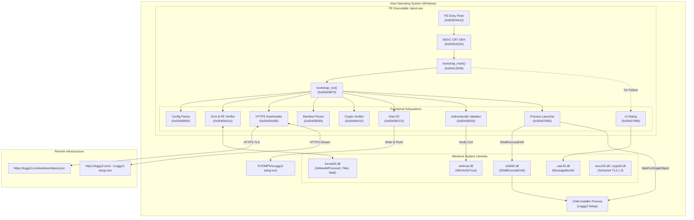
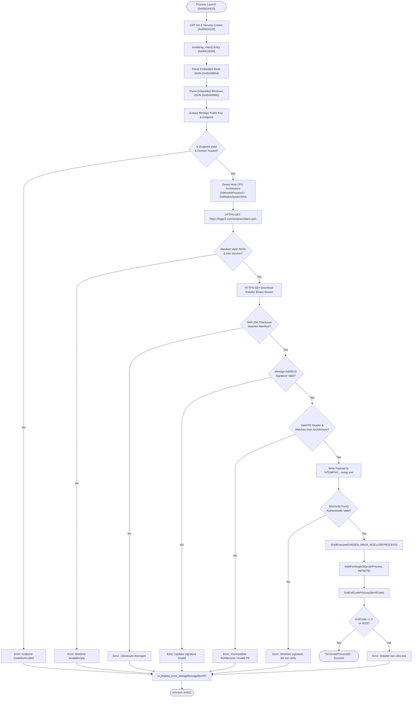
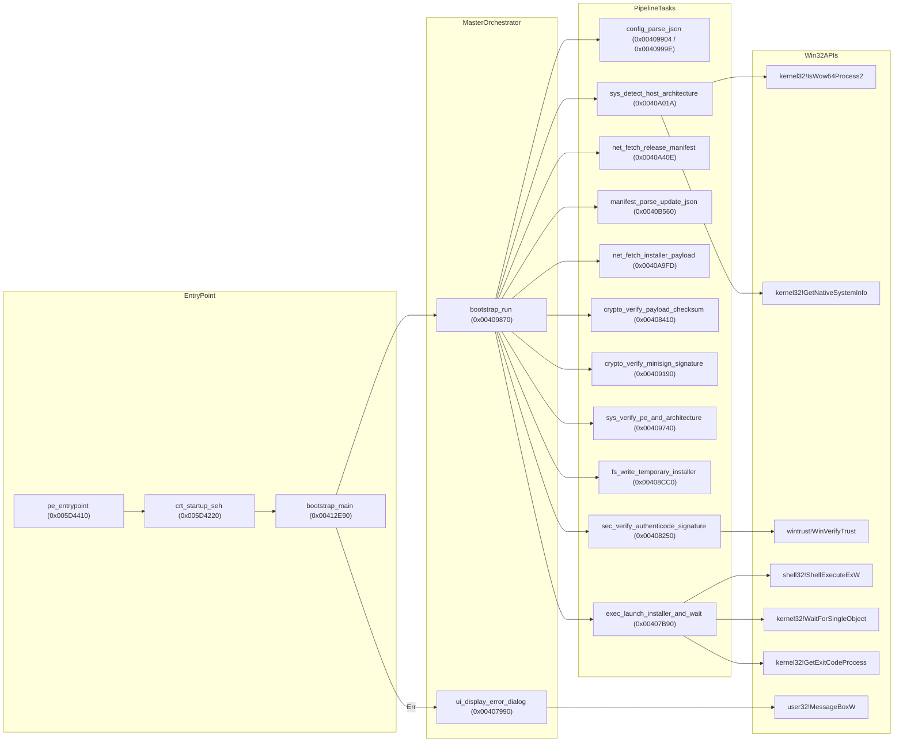
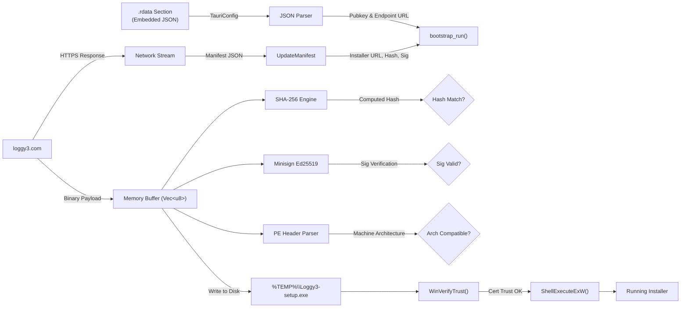
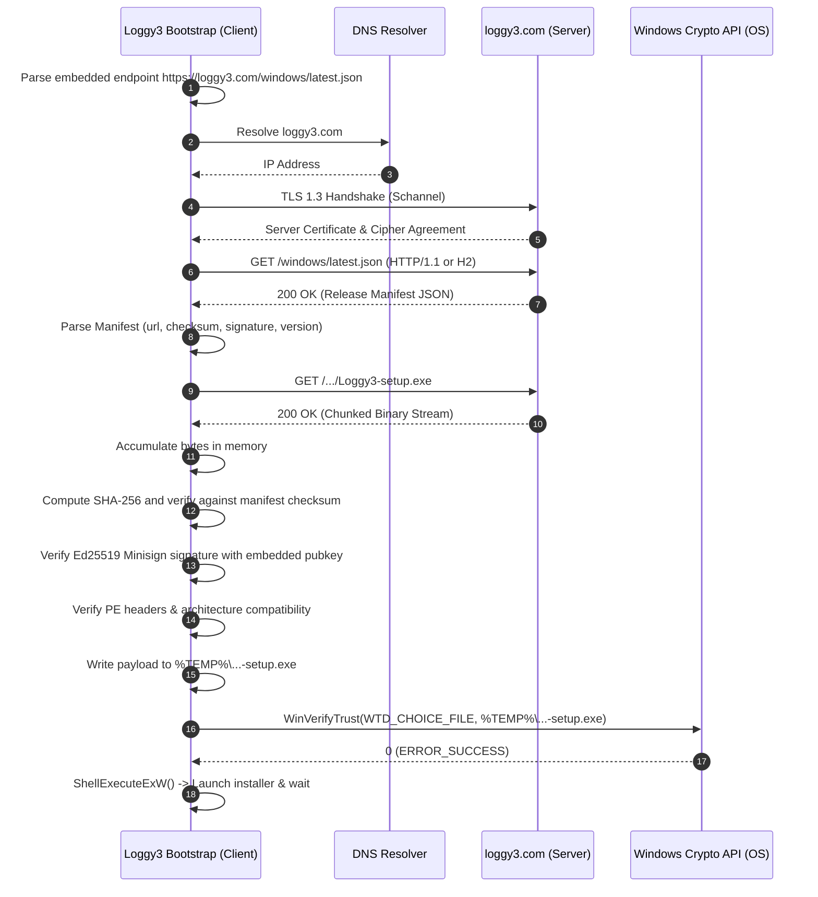

# Architecture & Execution Flow: Loggy3 Bootstrap (`latest.exe`)

## 1. Overall System Design & Modular Organization

`latest.exe` is a specialized, security-hardened **bootstrap installer and launcher** built in Rust for the **Loggy3 recorder suite** (identifier: `com.loggy3.recorder`). Its primary objective is to safely retrieve, cryptographically verify, and execute the full Loggy3 platform installer on Windows endpoints without bundling multi-megabyte payloads in initial distribution channels.

### Key Architectural Characteristics
* **Language & Compiler:** Rust 2021 edition (compiled with `rustc 1.83+` / LLVM 19, cross-compiled from macOS x86_64 to `i686-pc-windows-msvc`).
* **Framework:** Custom minimal Tauri bootstrap stub (`gui/src-tauri/src/bin/loggy3-bootstrap.rs`).
* **Subsystem:** Windows GUI (`subsystem: 0x0002`). Executes completely silently without a console window unless an error occurs, in which case a native modal dialog is presented.
* **Threading Model:** Synchronous orchestrator on the main thread, utilizing Tokio/Futures asynchronous non-blocking I/O runtime underneath for network streaming.
* **Services / Drivers:** None installed or managed by this executable.
* **IPC Mechanisms:** Standard Win32 process handles (`hProcess`) and process exit synchronization (`WaitForSingleObject`, `GetExitCodeProcess`).
* **Configuration Sources:** Hardcoded embedded JSON configurations stored in `.rdata` section (`tauri.conf.json` base configuration and Windows platform overlay).

---

## 2. Mermaid Diagrams

### (a) Component & Architecture Diagram

### (b) Execution Flowchart

### (c) Call Graph of Core Functions

### (d) Data-Flow Diagram

### (e) Network Sequence Diagram

---

## 3. Core Components Table

| Component Name | Memory Location | Purpose | Inputs | Outputs | Primary Dependencies |
|---|---|---|---|---|---|
| **Bootstrap Entry & SEH** | `0x005D4220` - `0x005D47C0` | Initializes MSVC CRT, sets up structured exception filters, configures memory cookies | Execution environment | Initialized process context | `ntdll.dll`, `kernel32.dll` |
| **Main Orchestrator** | `0x00412E90` & `0x00409870` | Directs the 16-step bootstrap lifecycle, catches errors, invokes modal dialogs | Embedded configs, OS state | Child process execution | Rust runtime, `bootstrap_run` |
| **Config Parser** | `0x00409904` - `0x00409A60` | Deserializes embedded base and platform JSON configs | Embedded strings at `0x005E23C0` | `TauriConfig` struct | `serde_json` |
| **Architecture Validator** | `0x0040A01A` & `0x00409740` | Discovers host CPU architecture and verifies downloaded binary PE machine type | System context, raw PE bytes | `Result<ProcessorArchitecture, Err>` | `kernel32!IsWow64Process2`, `GetNativeSystemInfo` |
| **Downloader Engine** | `0x0040A40E` - `0x0040B560` | Issues HTTPS requests with TLS validation and streams responses with size bounds | Validated URLs | In-memory byte buffers | `reqwest`, `hyper`, `schannel`, `ws2_32.dll` |
| **Manifest Parser** | `0x0040B560` - `0x0040B7D0` | Parses JSON release manifest into structured release attributes | Manifest JSON bytes | `UpdateManifest` struct | `serde_json` |
| **Crypto Verifier** | `0x00408410` & `0x00409190` | Validates payload SHA-256 checksum and Ed25519 Minisign digital signature | Payload bytes, signature, pubkey | `Result<(), Err>` | `sha2`, `ed25519-dalek`, `base64` |
| **Disk Manager** | `0x00408CC0` - `0x00409190` | Creates temporary setup executable in `%TEMP%` and commits payload | In-memory bytes, URL filename | On-disk file path | `kernel32!CreateFileW`, `WriteFile`, `GetTempPathW` |
| **Authenticode Validator** | `0x00408250` - `0x00408410` | Validates digital signature and certificate chain of the downloaded file | On-disk file path | `Result<(), Err>` | `wintrust!WinVerifyTrust` |
| **Process Launcher** | `0x00407B90` - `0x00408070` | Spawns child installer process, waits for termination, and evaluates exit code | File path | `Result<(), Err>` | `shell32!ShellExecuteExW`, `kernel32!WaitForSingleObject` |
| **UI Dialog Dispatcher** | `0x00407990` - `0x00407B90` | Renders native Windows error dialog on any failure condition | Title & message strings | Native modal display | `user32!MessageBoxW` |

